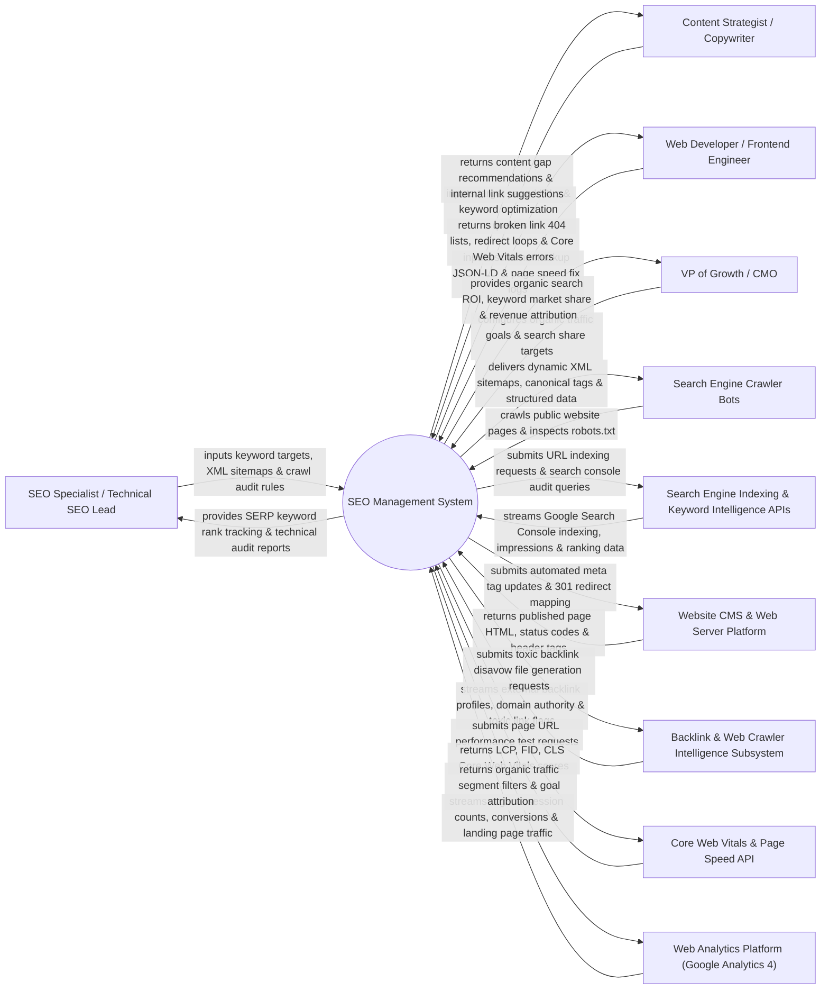

# Context Diagram — SEO Management System

## Mermaid Code

## Actor & Interaction Table | Bảng Actor & Tương tác

| # | Actor | Actor Type | Data Sent TO System | Data Received FROM System | Notes |
|---|-------|------------|---------------------|---------------------------|-------|
| 1 | SEO Specialist / Technical SEO Lead | Primary | Target keyword lists, XML sitemap configurations, technical crawl audit parameters, canonical URL rules. | Daily SERP keyword rank positions, technical site audit error logs, duplicate content alerts, cannibalization warnings. | Technical SEO professional managing organic search visibility, site architecture, and keyword rankings. |
| 2 | Content Strategist / Copywriter | Primary | Target page URLs, content optimization queries, secondary keyword targets. | Content gap analysis, search intent recommendations, internal linking opportunity suggestions. | Copywriter optimizing web page copy and metadata to capture high-intent search queries. |
| 3 | Web Developer / Frontend Engineer | Primary | Schema markup (JSON-LD) code, 301 redirect maps, Core Web Vitals remediation logs. | 404 broken link lists, redirect loop warnings, mobile usability errors, page speed diagnostic logs. | Developer resolving technical SEO errors, fixing crawl bloat, and accelerating page load speeds. |
| 4 | VP of Growth / CMO | Primary | Organic search revenue goals, market share benchmarks, search acquisition targets. | Organic search ROI reports, organic revenue attribution, keyword Share of Voice (SOV), competitive rank trends. | Executive evaluating organic search channel performance and business impact. |
| 5 | Search Engine Crawler Bots (Googlebot/Bingbot) | Supporting | Public web page crawling requests, robots.txt inspection queries, HTTP header checks. | Dynamic XML sitemaps, canonical URL tags, JSON-LD structured data markup, 301 redirect responses. | Search engine spiders crawling website pages to index content into search engine databases. |
| 6 | Search Engine Indexing & Keyword Intelligence APIs | Supporting | Google Search Console indexing status, impressions, CTR, average position data, Ahrefs/Semrush keyword volumes. | Automated URL indexing submission requests, Search Console audit queries, keyword rank tracking jobs. | Search engine APIs (Google Search Console API, Ahrefs API, Semrush API) providing official search performance data. |
| 7 | Website CMS & Web Server Platform | Supporting | Published page HTML, HTTP status codes (200, 301, 404, 500), response header tags. | Automated meta title/description updates, 301 redirect rule dispatches, XML sitemap submissions. | Web platform (WordPress, Webflow, Nginx/Apache) hosting website content and handling HTTP redirects. |
| 8 | Backlink & Web Crawler Intelligence Subsystem | Supporting | External backlink profile data, Domain Authority (DA) / Domain Rating (DR) scores, toxic backlink flags. | Toxic backlink disavow file generation requests, lost backlink alert queries, link building prospect lists. | Web crawler service analyzing external backlink profiles and identifying toxic links. |
| 9 | Core Web Vitals & Page Speed API | Supporting | Largest Contentful Paint (LCP), First Input Delay (FID), Cumulative Layout Shift (CLS) scores, PageSpeed Insights. | Page URL performance audit requests, mobile vs desktop speed test jobs. | Google PageSpeed Insights API measuring real-user Core Web Vitals experience metrics. |
| 10 | Web Analytics Platform (Google Analytics 4) | Supporting | Organic session counts, landing page traffic, organic goal conversions, bounce rates. | Organic traffic segment filters, organic landing page revenue attribution queries. | Analytics platform measuring organic search traffic, session engagement, and conversion revenue. |

## System Boundary Description | Mô tả Phạm vi Hệ thống

The **SEO Management System** is an enterprise technical SEO audit, SERP keyword rank tracking, backlink intelligence, and search engine optimization platform designed to maximize organic search engine visibility, traffic, and revenue.

**Inside System Scope:**
- Technical SEO site crawler auditing 404 broken links, redirect loops, duplicate meta tags, and crawl depth.
- Daily SERP rank tracking across desktop/mobile locations for thousands of target keywords with SERP feature tracking (Featured Snippets, People Also Ask).
- Integration with Google Search Console API for automated URL indexing submission and Search Console data aggregation.
- Backlink profile analysis, Domain Authority tracking, and automated Google Disavow file generation for toxic links.
- Schema markup (JSON-LD) generator, XML sitemap manager, and Core Web Vitals (LCP, FID, CLS) performance diagnostics.

**Outside System Scope:**
- Direct modification of Google's proprietary search ranking algorithms (handled exclusively by Google Search).
- Direct purchasing of paid PPC sponsored ads (handled by PPC Campaign Management Systems).
- Direct hosting of physical DNS domain name servers (handled by DNS Hosting Providers).
