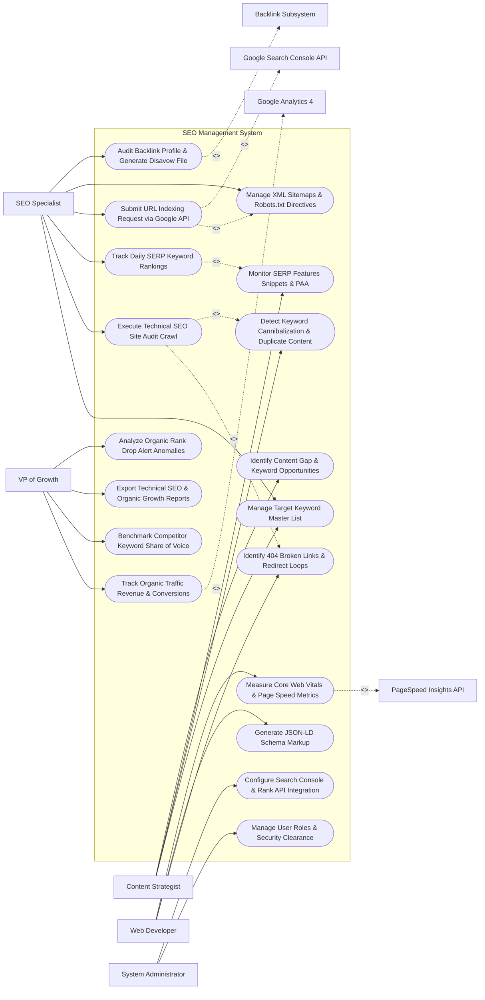

# Use Case Diagram — SEO Management System

## Mermaid Code

## Actor Table | Bảng Actor

| # | Actor | Actor Type | Role Description | Related Use Cases |
|---|-------|------------|------------------|-------------------|
| 1 | SEO Specialist | Primary | Technical SEO lead running site audit crawls, tracking daily keyword rankings, managing sitemaps, and disavowing toxic links. | UC01, UC02, UC05, UC08, UC09, UC10 |
| 2 | Content Strategist | Primary | Copywriter analyzing keyword cannibalization, tracking featured snippets, and identifying content gaps. | UC01, UC04, UC06, UC11 |
| 3 | Web Developer | Primary | Frontend engineer resolving 404 broken link errors, building JSON-LD schema markup, and optimizing Core Web Vitals. | UC03, UC07, UC12 |
| 4 | VP of Growth | Primary | Executive reviewing organic traffic conversions, competitor Share of Voice (SOV), rank drop alerts, and SEO ROI. | UC13, UC14, UC15, UC18 |
| 5 | System Administrator | Primary | IT administrative user managing user RBAC roles, Search Console OAuth integration, and rank tracking API keys. | UC16, UC17 |
| 6 | Google Search Console API | System (Secondary) | Official Google Search Console API transmitting indexing data, impressions, CTR, and receiving URL indexing requests. | UC08 |
| 7 | Backlink Subsystem | System (Secondary) | Backlink intelligence engine analyzing external link profiles, Domain Authority, and toxic link flags. | UC10 |
| 8 | PageSpeed Insights API | System (Secondary) | Google PageSpeed Insights API returning Core Web Vitals (LCP, FID, CLS) performance metrics. | UC12 |
| 9 | Google Analytics 4 | System (Secondary) | Analytics service streaming organic session traffic, landing page conversions, and goal attribution. | UC13 |

## Use Case Table | Bảng Use Case

| # | UC ID | Use Case Name | Primary Actor | Secondary Actor | Description | Priority |
|---|-------|---------------|---------------|-----------------|-------------|----------|
| 1 | UC01 | Manage Target Keyword Master List | SEOSpecialist | None | Centralizes target keyword lists, search volume metrics, keyword difficulty scores, and assigned target URLs. | High |
| 2 | UC02 | Execute Technical SEO Site Audit Crawl | SEOSpecialist | None | Executes automated web crawler to audit technical SEO health, status codes, canonical tags, and crawl depth. | Critical |
| 3 | UC03 | Identify 404 Broken Links & Redirect Loops | Developer | None | Detects 404 page errors, broken internal/external hyperlinks, and 301 redirect loops across website URLs. | High |
| 4 | UC04 | Detect Keyword Cannibalization & Duplicate Content | ContentStrategist | None | Flags multiple internal pages competing for the same target keyword or displaying identical meta tags. | High |
| 5 | UC05 | Track Daily SERP Keyword Rankings | SEOSpecialist | None | Tracks daily search engine ranking positions (1-100) across desktop/mobile search engines and geo-locations. | Critical |
| 6 | UC06 | Monitor SERP Features Snippets & PAA | ContentStrategist | None | Tracks brand visibility in SERP features (Featured Snippets, People Also Ask boxes, Knowledge Panels). | High |
| 7 | UC07 | Generate JSON-LD Schema Markup | Developer | None | Builds valid JSON-LD structured data code (Article, Product, FAQ, Organization) for enhanced SERP rich snippets. | High |
| 8 | UC08 | Submit URL Indexing Request via Google API | SEOSpecialist | SearchConsole | Automatically submits newly published or updated page URLs to Google Search Console Indexing API. | Critical |
| 9 | UC09 | Manage XML Sitemaps & Robots.txt Directives | SEOSpecialist | None | Generates dynamic `sitemap.xml` files and configures `robots.txt` disallow rules for search crawlers. | High |
| 10 | UC10 | Audit Backlink Profile & Generate Disavow File | SEOSpecialist | BacklinkEngine | Analyzes inbound backlink profiles, identifies toxic spam links, and formats Google Disavow text files (`disavow.txt`). | Critical |
| 11 | UC11 | Identify Content Gap & Keyword Opportunities | ContentStrategist | None | Compares domain keyword rankings against top competitors to discover un-targeted high-volume keywords. | High |
| 12 | UC12 | Measure Core Web Vitals & Page Speed Metrics | Developer | PageSpeedAPI | Audits page performance scores and real-user Core Web Vitals metrics (LCP, FID, CLS) for mobile and desktop. | High |
| 13 | UC13 | Track Organic Traffic Revenue & Conversions | GrowthVP | GA4 | Integrates GA4 data to measure organic search sessions, landing page conversion rates, and revenue attribution. | High |
| 14 | UC14 | Benchmark Competitor Keyword Share of Voice | GrowthVP | None | Calculates domain organic search Share of Voice (SOV) percentage compared to top 5 industry competitors. | High |
| 15 | UC15 | Export Technical SEO & Organic Growth Reports | GrowthVP | None | Renders automated technical health scorecards, rank movement summaries, and executive PDF reports. | High |
| 16 | UC16 | Manage User Roles & Security Clearance | Admin | None | Controls user login accounts, RBAC permissions, and domain audit project access limits. | High |
| 17 | UC17 | Configure Search Console & Rank API Integration | Admin | None | Configures OAuth 2.0 connections to Google Search Console, Bing Webmaster Tools, and rank APIs. | High |
| 18 | UC18 | Analyze Organic Rank Drop Alert Anomalies | GrowthVP | None | Triggers immediate alert notifications when high-value target keywords suffer a ranking drop $> 5$ positions. | Critical |

## Use Case Specification | Đặc tả Use Case

---

### UC02 — Execute Technical SEO Site Audit Crawl

| Field | Detail |
|-------|--------|
| **UC ID** | UC02 |
| **Use Case Name** | Execute Technical SEO Site Audit Crawl |
| **Actor(s)** | Primary: SEO Specialist / Technical SEO Lead   Secondary: None |
| **Description** | Launches an automated high-speed web crawler to scan all domain URLs, auditing HTTP status codes, meta tags, canonical alignment, robots directives, image ALT attributes, and crawl depth. |
| **Precondition** | 1. Domain URL (e.g., `https://company.com`) is configured in the audit module.   2. Crawler rate limits and user-agent string are set. |
| **Main Flow** | 1. Specialist opens "Technical SEO Site Audit Console" and clicks "Start New Audit Crawl".   2. Specialist sets Crawl Scope: `Full Site Crawl (Limit: 50,000 URLs)` and User-Agent: `Googlebot Desktop`.   3. System launches crawler engine, recursively following internal links across the domain.   4. System inspects each crawled URL payload:   &nbsp;&nbsp;&nbsp;&nbsp; a. HTTP Status Code (200 OK, 301 Redirect, 404 Not Found, 500 Server Error).   &nbsp;&nbsp;&nbsp;&nbsp; b. Title Tag Length (Verifies 50-60 character limit) & Meta Description.   &nbsp;&nbsp;&nbsp;&nbsp; c. Canonical Tag Alignment (Self-referential vs cross-domain canonical).   &nbsp;&nbsp;&nbsp;&nbsp; d. Robots Meta Tags (`index, follow` vs `noindex, nofollow`).   &nbsp;&nbsp;&nbsp;&nbsp; e. Image ALT Attributes (Flags missing ALT text on images).   5. System computes Overall Technical Health Score: `88 / 100`.   6. System categorizes issues by severity:   &nbsp;&nbsp;&nbsp;&nbsp; a. High Severity Errors: 14 Broken Links (404), 2 Redirect Loops.   &nbsp;&nbsp;&nbsp;&nbsp; b. Medium Warnings: 42 Pages Missing Meta Description.   &nbsp;&nbsp;&nbsp;&nbsp; c. Low Notices: 120 Images Missing ALT Text.   7. System renders issue breakdown graphs and exports prioritized action item task list for developers. |
| **Alternative Flow** | **AF1** — Scheduled Weekly Crawl: Specialist configures "Weekly Automated Crawl on Sundays at 02:00 AM"; System automatically runs crawl and emails diff report comparing health score vs previous week. |
| **Exception Flow** | **EX1** — Server WAF Rate Limit Block: Target web server returns 429 Too Many Requests due to aggressive crawl speed; System automatically lowers crawl rate (from 20 requests/sec to 2 requests/sec) and resumes crawl. |
| **Postcondition** | Technical site audit crawl is completed, health score is calculated, and categorized issue action lists are generated. |
| **Business Rule** | **BR1**: Technical site audit crawls MUST respect `robots.txt` disallow directives unless explicitly overridden in administrative testing mode. |

---

### UC05 — Track Daily SERP Keyword Rankings

| Field | Detail |
|-------|--------|
| **UC ID** | UC05 |
| **Use Case Name** | Track Daily SERP Keyword Rankings |
| **Actor(s)** | Primary: SEO Specialist / Technical SEO Lead   Secondary: None |
| **Description** | Queries search engine API engines daily to track exact search ranking positions (Positions 1 to 100) for target keywords across desktop/mobile devices and specific geographic locations. |
| **Precondition** | 1. Target keywords are added to Master Keyword List (UC01).   2. Target geo-locations (e.g., United States, California) and devices (Desktop/Mobile) are configured. |
| **Main Flow** | 1. System initiates automated daily SERP rank tracking job at 00:00 UTC.   2. System queries SERP tracking proxy engine for each active keyword (e.g., Keyword: `cloud ERP software` in `United States - Desktop`).   3. System retrieves top 100 Search Engine Result Page (SERP) URLs for the query.   4. System locates company target URL (`https://company.com/cloud-erp`) within SERP results.   5. System records Current Rank Position: `Position #3` (Previous Day: Position #5 -> `+2 Change`).   6. System detects SERP Features Present:   &nbsp;&nbsp;&nbsp;&nbsp; a. Featured Snippet (Position #0): `NO`.   &nbsp;&nbsp;&nbsp;&nbsp; b. People Also Ask (PAA) Box: `YES (Company URL listed in PAA)`.   7. System updates master rank database and calculates aggregate rank metrics:   &nbsp;&nbsp;&nbsp;&nbsp; a. Average Keyword Rank: `Position 8.4`.   &nbsp;&nbsp;&nbsp;&nbsp; b. Top 3 Keywords: 42 Keywords.   &nbsp;&nbsp;&nbsp;&nbsp; c. Top 10 Keywords: 184 Keywords.   8. Specialist opens "SERP Rank Tracking Dashboard" to view rank movement trendlines and rank distribution heatmaps. |
| **Alternative Flow** | **AF1** — Mobile vs Desktop Rank Split: System records Mobile Rank `#6` vs Desktop Rank `#3`, flagging a 3-position mobile rank drop for mobile usability investigation (UC12). |
| **Exception Flow** | **EX1** — Unranked Keyword ($> 100$): Target URL is not found within top 100 SERP results; System records rank as `> 100 (Unranked)` and flags keyword for content optimization (UC11). |
| **Postcondition** | Daily SERP keyword rankings are recorded, rank movement changes (+/-) are calculated, and dashboard trendlines update. |
| **Business Rule** | **BR1**: SERP rank tracking jobs MUST execute daily dispatches using localized IP proxies matching the exact target geographic location. |

---

### UC08 — Submit URL Indexing Request via Google API

| Field | Detail |
|-------|--------|
| **UC ID** | UC08 |
| **Use Case Name** | Submit URL Indexing Request via Google API |
| **Actor(s)** | Primary: SEO Specialist / Technical SEO Lead   Secondary: Google Search Console API |
| **Description** | Automatically submits newly created or updated web page URLs directly to the Google Search Console Indexing API to accelerate search engine crawl and indexation. |
| **Precondition** | 1. Google Search Console API OAuth 2.0 credentials are authorized (UC17).   2. Web page URL is published and returns HTTP 200 OK status. |
| **Main Flow** | 1. System detects a new or updated page event on website CMS (e.g., New Blog Post `https://company.com/blog/cloud-security-2026`).   2. System verifies URL health pre-checks:   &nbsp;&nbsp;&nbsp;&nbsp; a. HTTP Status Code: `200 OK`.   &nbsp;&nbsp;&nbsp;&nbsp; b. Robots Tag: `index, follow`.   &nbsp;&nbsp;&nbsp;&nbsp; c. Canonical URL: Self-referential match.   3. System constructs JSON-LD payload for Google Indexing API endpoint:   &nbsp;&nbsp;&nbsp;&nbsp; a. `url`: `https://company.com/blog/cloud-security-2026`.   &nbsp;&nbsp;&nbsp;&nbsp; b. `type`: `URL_UPDATED`.   4. System transmits payload over secure HTTPS OAuth API to Google Search Console API.   5. Google API processes request and returns success response (`200 OK - URL_QUEUED_FOR_INDEXING`).   6. System updates indexing log: Marks URL as `INDEX_REQUESTED` with timestamp.   7. After 4 hours, System checks Google Search Console API for indexation verification; System confirms `URL_INDEXED_ON_GOOGLE`. |
| **Alternative Flow** | **AF1** — Bulk Sitemaps Indexing Submission: Specialist submits full XML sitemap containing 500 URLs; System batches URLs and transmits indexation requests within Google daily quota limits.   **AF2** — URL Removal Request: Page is deleted (HTTP 410); System sends API request with `type: URL_DELETED` to immediately remove URL from Google SERPs. |
| **Exception Flow** | **EX1** — Google Daily API Quota Exceeded: Daily indexing API limit (200 requests/day) is reached; System queues remaining URLs in "Pending Indexing Queue" for automatic submission at 00:00 UTC. |
| **Postcondition** | URL indexing request is transmitted to Google Search Console API, and URL indexation status is logged. |
| **Business Rule** | **BR1**: Indexing requests MUST only be submitted for URLs returning HTTP 200 OK with valid `index, follow` robots directives. |

---

### UC10 — Audit Backlink Profile & Generate Disavow File

| Field | Detail |
|-------|--------|
| **UC ID** | UC10 |
| **Use Case Name** | Audit Backlink Profile & Generate Disavow File |
| **Actor(s)** | Primary: SEO Specialist / Technical SEO Lead   Secondary: Backlink Subsystem |
| **Description** | Analyzes domain external inbound backlink profiles, calculates toxic link risk scores, and formats a Google-compliant Disavow text file (`disavow.txt`) to protect the domain from algorithmic spam penalties. |
| **Precondition** | 1. Backlink intelligence API connection (Ahrefs/Semrush/Moz) is active. |
| **Main Flow** | 1. Specialist opens "Backlink Profile & Toxic Link Audit Console".   2. System retrieves external backlink profile data from Backlink Subsystem:   &nbsp;&nbsp;&nbsp;&nbsp; a. Total Backlinks: 142,000 inbound links.   &nbsp;&nbsp;&nbsp;&nbsp; b. Referring Domains: 2,400 unique domains.   &nbsp;&nbsp;&nbsp;&nbsp; c. Domain Authority (DA) / Domain Rating (DR): `DR 68`.   3. System evaluates Toxic Link Risk Algorithm across referring domains:   &nbsp;&nbsp;&nbsp;&nbsp; a. Spam Network Pattern (Mass automated links from known PBNs).   &nbsp;&nbsp;&nbsp;&nbsp; b. Irrelevant TLD Spikes (e.g., thousands of spam links from `.xyz` or `.top` domains).   &nbsp;&nbsp;&nbsp;&nbsp; c. Exact-Match Over-Optimized Anchor Text Spikes.   4. System identifies Toxic Link Candidates: `120 Toxic Domains` (Toxic Risk Score > 80/100).   5. Specialist reviews flagged domains and clicks "Add Selected Domains to Disavow List".   6. System compiles Google-formatted Disavow Text File (`disavow.txt`):   &nbsp;&nbsp;&nbsp;&nbsp; `# Disavow File Generated on 2026-10-30`   &nbsp;&nbsp;&nbsp;&nbsp; `domain:spammysite1.xyz`   &nbsp;&nbsp;&nbsp;&nbsp; `domain:badlinkfarm2.top`   7. Specialist clicks "Download Disavow File" and submits file to Google Search Console Disavow Tool.   8. System logs disavow submission date and flags domains as `DISAVOWED` in master backlink database. |
| **Alternative Flow** | **AF1** — Lost Backlink Alert: System detects loss of 15 high-authority (DR > 70) backlinks; System alerts Specialist with backlink details for outreach recovery. |
| **Exception Flow** | **EX1** — Accidental High-Authority Disavow Warning: Specialist attempts to disavow a high-authority news domain (`nytimes.com`); System displays bold red warning alert "Caution: Disavowing High-Authority Domain (DR 92) - Confirm Action", requiring double confirmation. |
| **Postcondition** | Toxic backlinks are audited, Google-compliant `disavow.txt` file is generated, and disavow history is archived. |
| **Business Rule** | **BR1**: Generated disavow files MUST adhere strictly to Google Disavow syntax formatting (`domain:example.com` or explicit URL strings). |

---

### UC12 — Measure Core Web Vitals & Page Speed Metrics

| Field | Detail |
|-------|--------|
| **UC ID** | UC12 |
| **Use Case Name** | Measure Core Web Vitals & Page Speed Metrics |
| **Actor(s)** | Primary: Web Developer / Frontend Engineer   Secondary: PageSpeed Insights API |
| **Description** | Audits web page loading speeds and field-tested Core Web Vitals metrics—Largest Contentful Paint (LCP), First Input Delay (FID/INP), Cumulative Layout Shift (CLS)—for mobile and desktop devices. |
| **Precondition** | 1. PageSpeed Insights API key is configured.   2. Target page URL is accessible publicly. |
| **Main Flow** | 1. Developer opens "Core Web Vitals & Performance Audit Console".   2. Developer enters target page URL (e.g., `https://company.com/product-page`) and selects Device: `Mobile (Chrome Emulation)`.   3. System transmits audit request to Google PageSpeed Insights API.   4. PageSpeed Insights API executes synthetic Lighthouse test and fetches real-user Chrome User Experience (CrUX) field data.   5. System receives Core Web Vitals metrics response:   &nbsp;&nbsp;&nbsp;&nbsp; a. Overall Performance Score: `64 / 100` (POOR - Needs Improvement).   &nbsp;&nbsp;&nbsp;&nbsp; b. Largest Contentful Paint (LCP): `3.8 seconds` (Target: <= 2.5s -> FAIL).   &nbsp;&nbsp;&nbsp;&nbsp; c. Interaction to Next Paint (INP): `180 ms` (Target: <= 200ms -> PASS).   &nbsp;&nbsp;&nbsp;&nbsp; d. Cumulative Layout Shift (CLS): `0.18` (Target: <= 0.10 -> FAIL).   6. System highlights performance bottleneck diagnostic recommendations:   &nbsp;&nbsp;&nbsp;&nbsp; a. LCP Diagnostic: "Uncompressed hero image (2.4 MB) -> Convert to WebP and apply `fetchpriority=high`".   &nbsp;&nbsp;&nbsp;&nbsp; b. CLS Diagnostic: "Unsized image elements causing layout shifts -> Set explicit width/height CSS attributes".   7. Developer clicks "Export Developer Ticket", creating a Jira/GitHub issue with exact diagnostic instructions. |
| **Alternative Flow** | **AF1** — Bulk Site Core Web Vitals Audit: System audits top 100 landing pages, rendering a site-wide Core Web Vitals status matrix (Good vs Needs Improvement vs Poor). |
| **Exception Flow** | **EX1** — Insufficient CrUX Field Data: Target page has low traffic and lacks Chrome User Experience (CrUX) field data; System defaults to displaying synthetic Lighthouse lab data with a note "Lab Data Only - Insufficient Field Data". |
| **Postcondition** | Core Web Vitals metrics (LCP, INP, CLS) are measured, speed bottlenecks are diagnosed, and developer remediation tickets are created. |
| **Business Rule** | **BR1**: Core Web Vitals assessments MUST evaluate both synthetic Lighthouse lab data and Google CrUX real-user field data. |
