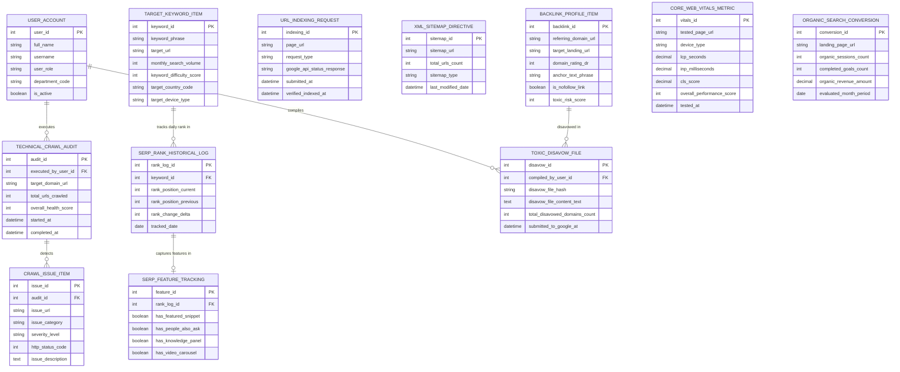

# Conceptual ERD — SEO Management System

## Mermaid Code

## Entity Description Table | Bảng mô tả Entity

| # | Entity Name | Vietnamese Name | Description | Key Attributes | Main Relationships |
|---|-------------|-----------------|-------------|----------------|-------------------|
| 1 | USER_ACCOUNT | Tài khoản Nguời dùng | System user credentials and access roles for SEO specialists, copywriters, developers, and growth VPs. | `user_id`, `username`, `user_role`, `department_code` | Executes `TECHNICAL_CRAWL_AUDIT`, compiles `TOXIC_DISAVOW_FILE`. |
| 2 | TARGET_KEYWORD_ITEM | Từ khóa Mục tiêu | Master keyword entity storing search phrase, target URL, search volume, difficulty, country, and device type. | `keyword_id`, `keyword_phrase`, `target_url`, `monthly_search_volume`, `keyword_difficulty_score` | Tracks daily rank in `SERP_RANK_HISTORICAL_LOG`. |
| 3 | SERP_RANK_HISTORICAL_LOG | Nhật ký Thứ hạng SERP | Daily SERP ranking position logs tracking rank movements (+/-) and position changes over time. | `rank_log_id`, `keyword_id`, `rank_position_current`, `rank_position_previous`, `rank_change_delta`, `tracked_date` | Belongs to `TARGET_KEYWORD_ITEM`, captures features in `SERP_FEATURE_TRACKING`. |
| 4 | SERP_FEATURE_TRACKING | Theo dõi Feature SERP | SERP feature visibility tracking capturing Featured Snippets, People Also Ask (PAA), and Knowledge Panels. | `feature_id`, `rank_log_id`, `has_featured_snippet`, `has_people_also_ask`, `has_knowledge_panel` | Belongs to `SERP_RANK_HISTORICAL_LOG`. |
| 5 | TECHNICAL_CRAWL_AUDIT | Audit Crawl Kỹ thuật SEO | Technical site audit crawl session header tracking total URLs crawled, health score, and timestamps. | `audit_id`, `executed_by_user_id`, `target_domain_url`, `total_urls_crawled`, `overall_health_score` | Detects `CRAWL_ISSUE_ITEM`, executed by `USER_ACCOUNT`. |
| 6 | CRAWL_ISSUE_ITEM | Lỗi Kỹ thuật Crawl SEO | Specific technical issue item (404 broken link, redirect loop, missing meta tag, duplicate content) detected during crawl. | `issue_id`, `audit_id`, `issue_url`, `issue_category`, `severity_level`, `http_status_code` | Belongs to `TECHNICAL_CRAWL_AUDIT`. |
| 7 | URL_INDEXING_REQUEST | Yêu cầu Index URL | Google Search Console API URL indexing submission log tracking request types and indexation timestamps. | `indexing_id`, `page_url`, `request_type`, `google_api_status_response`, `submitted_at` | Standalone API submission entity. |
| 8 | XML_SITEMAP_DIRECTIVE | Sitemap XML Hướng dẫn | Dynamic `sitemap.xml` index configuration tracking sitemap URL, URL count, and last modification dates. | `sitemap_id`, `sitemap_url`, `total_urls_count`, `sitemap_type`, `last_modified_date` | Standalone XML sitemap entity. |
| 9 | BACKLINK_PROFILE_ITEM | Backlink Inbound Link Item | Inbound backlink profile item tracking referring domain, target URL, Domain Rating (DR), anchor text, and toxic risk score. | `backlink_id`, `referring_domain_url`, `target_landing_url`, `domain_rating_dr`, `toxic_risk_score` | Disavowed in `TOXIC_DISAVOW_FILE`. |
| 10 | TOXIC_DISAVOW_FILE | File Disavow Spam Link | Google Disavow text file (`disavow.txt`) compilation record storing disavowed domain lists and submission dates. | `disavow_id`, `compiled_by_user_id`, `disavow_file_hash`, `disavow_file_content_text`, `submitted_to_google_at` | Disavows `BACKLINK_PROFILE_ITEM`, compiled by `USER_ACCOUNT`. |
| 11 | CORE_WEB_VITALS_METRIC | Chỉ số Core Web Vitals | PageSpeed Insights test metric recording LCP, INP, CLS scores, and overall performance scores for mobile/desktop. | `vitals_id`, `tested_page_url`, `device_type`, `lcp_seconds`, `inp_milliseconds`, `cls_score`, `overall_performance_score` | Standalone performance audit entity. |
| 12 | ORGANIC_SEARCH_CONVERSION | Chuyển đổi Search Tự nhiên | Monthly organic search analytics integration tracking landing page sessions, goal conversions, and revenue. | `conversion_id`, `landing_page_url`, `organic_sessions_count`, `completed_goals_count`, `organic_revenue_amount` | Standalone organic analytics entity. |

## Relationship Description | Mô tả Quan hệ

| # | From Entity | Cardinality | To Entity | Label | Business Explanation |
|---|-------------|-------------|-----------|-------|----------------------|
| 1 | TARGET_KEYWORD_ITEM | 1 to 0..N | SERP_RANK_HISTORICAL_LOG | tracks daily rank in | A target keyword item tracks daily ranking positions in historical logs. |
| 2 | SERP_RANK_HISTORICAL_LOG | 1 to 0..1 | SERP_FEATURE_TRACKING | captures features in | A SERP rank historical log captures SERP feature visibility (Featured Snippets/PAA). |
| 3 | TECHNICAL_CRAWL_AUDIT | 1 to 0..N | CRAWL_ISSUE_ITEM | detects | A technical crawl audit detects multiple technical issue items. |
| 4 | BACKLINK_PROFILE_ITEM | 1 to 0..N | TOXIC_DISAVOW_FILE | disavowed in | Toxic backlink profile items are disavowed in a Google Disavow file. |
| 5 | USER_ACCOUNT | 1 to 0..N | TECHNICAL_CRAWL_AUDIT | executes | An SEO specialist user account executes technical site crawl audits. |
| 6 | USER_ACCOUNT | 1 to 0..N | TOXIC_DISAVOW_FILE | compiles | An SEO specialist user account compiles disavow text files. |
