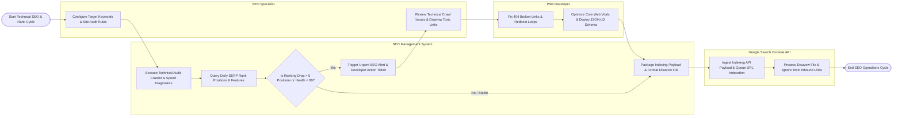

# Swimlane Diagram — SEO Management System

## Mermaid Code

## Flow Description | Mô tả luồng

| Lane | Actor | Role in Flow |
|------|-------|-------------|
| 1 | SEO Specialist | Configures target keywords, defines audit rules, reviews technical crawl health scorecards, and compiles toxic disavow link files. |
| 2 | Web Developer | Resolves 404 broken links and 301 redirect loops, optimizes Core Web Vitals (LCP/CLS), and deploys JSON-LD structured schema markup. |
| 3 | SEO Management System | Executes automated technical site audit crawlers, queries daily SERP rank positions, evaluates rank drop anomalies, generates developer tickets, and packages Google Search Console indexing/disavow API dispatches. |
| 4 | Google Search Console API | Ingests URL indexing API requests to accelerate search indexation and processes `disavow.txt` files to exclude toxic links from Google's ranking algorithms. |
