# Action Tree — SEO Management System

## Mermaid Code

```mermaid
graph TD
    Root["SEO Management System"]

    Root --> M1["Technical Site Audit & Crawler Engine"]
    Root --> M2["Daily SERP Rank & Feature Tracking"]
    Root --> M3["Search Console & Indexation API Integration"]
    Root --> M4["Backlink Intelligence & Disavow Manager"]
    Root --> M5["Core Web Vitals & Technical Optimization"]
    Root --> M6["Organic Traffic Analytics & Competitive SOV"]

    M1 --> A11["Execute Automated High-Speed Technical Site Crawls"]
    M1 --> A12["Audit 404 Broken Links, 301 Redirect Loops & HTTP Statuses"]
    M1 --> A13["Detect Keyword Cannibalization & Duplicate Meta Tags"]
    M1 --> A14["Inspect Robots.txt Directives & Canonical Alignment"]

    M2 --> A21["Track Daily Desktop & Mobile Localized SERP Rankings"]
    M2 --> A22["Monitor Featured Snippets & People Also Ask (PAA) Boxes"]
    M2 --> A23["Trigger Urgent Rank Drop Alert Notifications (> 5 Positions)"]
    M2 --> A24["Calculate Average Keyword Rank & Top 3/10 Distributions"]

    M3 --> A31["Submit URL Indexing Requests via Google Search Console API"]
    M3 --> A32["Ingest Search Console Clicks, Impressions & CTR Data"]
    M3 --> A33["Generate Dynamic Multi-Sitemap XML Files"]
    M3 --> A34["Monitor Google Indexation Status & Crawl Errors"]

    M4 --> A41["Audit External Inbound Backlink Profiles & Domain Ratings"]
    M4 --> A42["Identify Toxic Spam Links & Automated Link Farm Networks"]
    M4 --> A43["Compile Google-Compliant Disavow Text Files (disavow.txt)"]
    M4 --> A44["Alert on Lost High-Authority Backlinks (DR > 70)"]

    M5 --> A51["Audit Core Web Vitals (LCP, INP, CLS) Field & Lab Data"]
    M5 --> A52["Diagnose PageSpeed Insights Bottlenecks & Un-sized Media"]
    M5 --> A53["Build Valid JSON-LD Schema Markup (Article, Product, FAQ)"]
    M5 --> A54["Generate Prioritized Developer Technical Task Tickets"]

    M6 --> A61["Integrate GA4 Organic Session Traffic & Conversions"]
    M6 --> A62["Calculate Organic Search Revenue & Goal Attribution"]
    M6 --> A63["Benchmark Competitor Organic Search Share of Voice (SOV)"]
    M6 --> A64["Export Executive Technical SEO Health & Growth Reports"]
```

## Module Description | Mô tả Module

| # | Module | Description | Actions |
|---|--------|-------------|---------|
| 1 | Technical Site Audit & Crawler Engine | Audits technical SEO health, status codes, broken links, 301 redirect loops, canonical tags, and duplicate meta tags. | Execute Site Audits, Audit Status Codes, Detect Keyword Cannibalization, Inspect Robots.txt Directives. |
| 2 | Daily SERP Rank & Feature Tracking | Tracks daily desktop/mobile SERP rankings, monitors Featured Snippets/PAA boxes, and alerts on rank drops. | Track Daily SERP Ranks, Monitor SERP Features, Trigger Rank Drop Alerts, Calculate Average Rank Distributions. |
| 3 | Search Console & Indexation API Integration | Submits URL indexing requests via Google Search Console API, ingests CTR metrics, and manages XML sitemaps. | Submit Indexing API Requests, Ingest Search Console CTR Data, Generate XML Sitemaps, Monitor Indexation Status. |
| 4 | Backlink Intelligence & Disavow Manager | Audits inbound backlinks, identifies toxic link networks, compiles `disavow.txt` files, and alerts on lost backlinks. | Audit Backlink Profiles, Identify Toxic Spam Links, Compile Disavow Files, Alert on Lost Backlinks. |
| 5 | Core Web Vitals & Technical Optimization | Measures LCP/INP/CLS metrics via PageSpeed API, diagnoses bottlenecks, and builds JSON-LD schema code. | Audit Core Web Vitals, Diagnose PageSpeed Bottlenecks, Build JSON-LD Schema Markup, Generate Developer Task Tickets. |
| 6 | Organic Traffic Analytics & Competitive SOV | Integrates GA4 organic session traffic, measures organic search revenue, benchmarks competitor SOV, and exports reports. | Integrate GA4 Traffic, Measure Organic Search Revenue, Benchmark Competitor SOV, Export Executive Growth Reports. |
