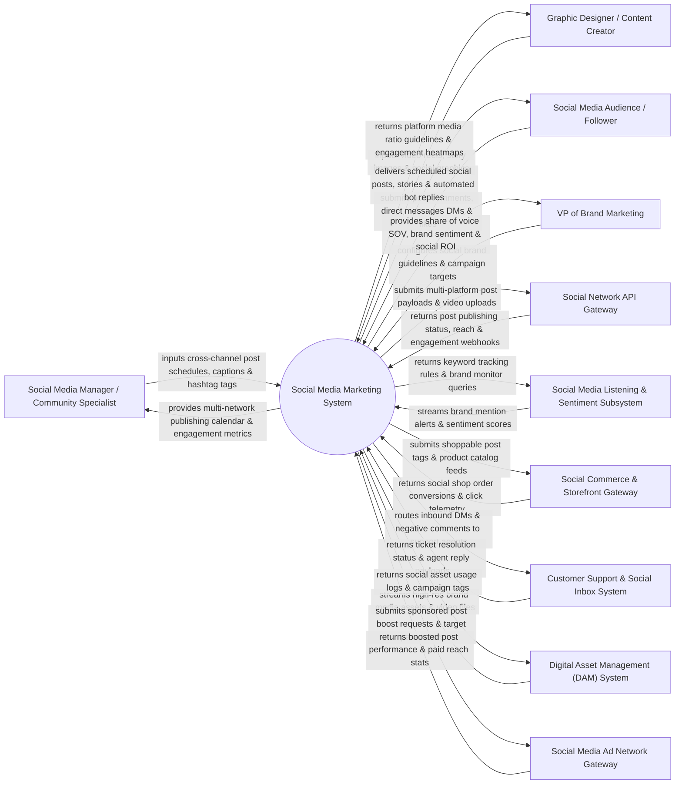

# Context Diagram — Social Media Marketing System

## Mermaid Code

## Actor & Interaction Table | Bảng Actor & Tương tác

| # | Actor | Actor Type | Data Sent TO System | Data Received FROM System | Notes |
|---|-------|------------|---------------------|---------------------------|-------|
| 1 | Social Media Manager / Community Specialist | Primary | Cross-channel post content, publishing schedules, hashtag strategies, comment responses, social contest rules. | Unified social content calendar, cross-network engagement analytics, best time to post recommendations, unified social inbox. | Specialist managing multi-platform social media profiles (Meta, X/Twitter, LinkedIn, TikTok, YouTube). |
| 2 | Graphic Designer / Content Creator | Primary | Social graphics, short-form video reels, story templates, GIF animations. | Aspect ratio auto-cropping previews (1:1, 9:16, 16:9), media upload validation, video performance metrics. | Creative designer crafting visual and video assets tailored to specific social media channel specifications. |
| 3 | Social Media Audience / Follower | Primary | Post likes, shares, comments, video views, direct messages (DMs), user-generated content (UGC). | Scheduled social posts, video reels, interactive polls, automated DM replies, contest confirmations. | Target social audience interacting with brand channels across social networks. |
| 4 | VP of Brand Marketing | Primary | Social brand voice guidelines, crisis escalation policies, quarterly follower growth targets. | Share of Voice (SOV) metrics, brand sentiment distribution, social campaign ROI, competitive benchmark charts. | Brand executive evaluating social media presence, viral campaign impact, and brand sentiment. |
| 5 | Social Network API Gateway (Meta/X/LinkedIn/TikTok/YouTube) | Supporting | Post publishing webhooks, organic reach numbers, follower counts, video completion rates, API rate limits. | Multi-platform post publishing payloads, video uploads, story media, API OAuth tokens. | Official REST/GraphQL APIs connecting the system to Meta (Facebook/Instagram), X (Twitter), LinkedIn, TikTok, and YouTube. |
| 6 | Social Media Listening & Sentiment Subsystem | Supporting | Brand mention volume feeds, keyword sentiment scores (Positive/Negative), trending hashtag alerts. | Brand keyword search queries, competitor tracking profiles, crisis threshold alert rules. | Social listening engine monitoring public web conversations, influencer mentions, and brand sentiment. |
| 7 | Social Commerce & Storefront Gateway | Supporting | Social shop checkout conversions, product tag click counts, social commerce revenue. | Shoppable post product tags, Instagram/TikTok shop catalog feeds, promo code tracking. | E-commerce integration enabling direct shoppable product tagging on social images and videos. |
| 8 | Customer Support & Social Inbox System | Supporting | Support agent DM replies, ticket resolution statuses, escalation notes. | Inbound customer DM inquiries, negative comment alerts, customer profile linkage. | Service portal routing customer service DMs and negative comments to support reps. |
| 9 | Digital Asset Management (DAM) System | Supporting | High-resolution brand images, approved video clips, brand logo overlays, licensed audio tracks. | Asset usage logs, social campaign tags, asset expiration tracking. | Central asset repository supplying licensed media assets for social publishing. |
| 10 | Social Media Ad Network Gateway | Supporting | Boosted post performance metrics, paid vs organic reach breakdowns, ad spend totals. | Organic post boosting requests, target audience parameters, ad budget allocations. | Paid advertising integration enabling seamless conversion of high-performing organic posts into paid ads. |

## System Boundary Description | Mô tả Phạm vi Hệ thống

The **Social Media Marketing System** is an enterprise social publishing, community management, social listening, and brand engagement platform designed to centralize multi-platform social media operations across Meta (Facebook/Instagram), X (Twitter), LinkedIn, TikTok, and YouTube.

**Inside System Scope:**
- Unified multi-channel social publishing calendar with drag-and-drop scheduling and automated best-time-to-post AI recommendations.
- Unified Social Inbox consolidating DMs, comments, and mentions from all networks into a single agent workspace.
- Social media listening, brand mention tracking, competitor benchmarking, and automated sentiment classification.
- Shoppable post creation, social commerce product tagging, and organic-to-paid post boosting workflows.
- Cross-platform analytics tracking engagement rates, follower growth, video watch times, and Share of Voice (SOV).

**Outside System Scope:**
- Direct physical filming of video footage (handled by Camera Operators and Film Crews).
- Direct enforcement of legal copyright strikes on third-party channels (handled by Copyright Attorneys).
- Direct financial settlement of social shop merchant transactions (handled by Payment Gateways).
