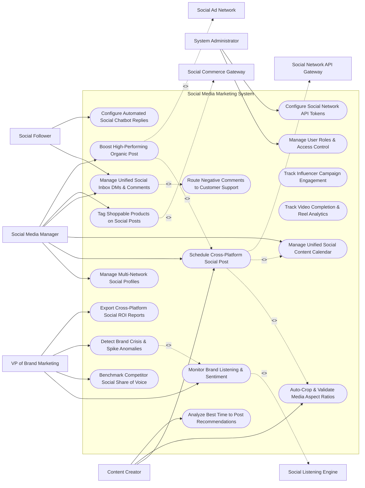

# Use Case Diagram — Social Media Marketing System

## Mermaid Code

## Actor Table | Bảng Actor

| # | Actor | Actor Type | Role Description | Related Use Cases |
|---|-------|------------|------------------|-------------------|
| 1 | Social Media Manager | Primary | Community specialist scheduling posts, managing content calendars, responding to DMs, and tagging shoppable products. | UC01, UC02, UC04, UC05, UC10, UC12 |
| 2 | Content Creator | Primary | Designer crafting video reels, stories, images, validating media aspect ratios, and checking optimal posting times. | UC02, UC03, UC18 |
| 3 | Social Follower | Primary | End user interacting with brand posts via comments, likes, shares, direct messages (DMs), and chatbot prompts. | UC05, UC06 |
| 4 | VP of Brand Marketing | Primary | Executive monitoring brand sentiment, social listening alerts, competitor Share of Voice (SOV), and ROI reports. | UC08, UC09, UC13, UC15 |
| 5 | System Administrator | Primary | IT administrative user managing user security roles, channel permissions, and social network API tokens. | UC16, UC17 |
| 6 | Social Network API Gateway | System (Secondary) | Official APIs (Meta, X, LinkedIn, TikTok, YouTube) receiving post publishing payloads and returning webhooks. | UC02 |
| 7 | Social Listening Engine | System (Secondary) | Specialized listening service monitoring public brand mentions, hashtag spikes, and sentiment scores. | UC08 |
| 8 | Social Commerce Gateway | System (Secondary) | E-commerce integration validating product catalog IDs for shoppable social post tagging. | UC10 |
| 9 | Social Ad Network | System (Secondary) | Paid advertising gateway receiving organic post boost requests and budget allocations. | UC12 |

## Use Case Table | Bảng Use Case

| # | UC ID | Use Case Name | Primary Actor | Secondary Actor | Description | Priority |
|---|-------|---------------|---------------|-----------------|-------------|----------|
| 1 | UC01 | Manage Multi-Network Social Profiles | SocialMgr | None | Connects and authorizes brand social profiles across Meta (FB/IG), X, LinkedIn, TikTok, and YouTube. | High |
| 2 | UC02 | Schedule Cross-Platform Social Post | SocialMgr | Social API | Drafts, customizes, and schedules social posts, carousels, and video reels across multiple networks simultaneously. | Critical |
| 3 | UC03 | Auto-Crop & Validate Media Aspect Ratios | Creator | None | Validates image and video aspect ratios (1:1, 9:16, 16:9), file sizes, and applies platform auto-cropping. | High |
| 4 | UC04 | Manage Unified Social Content Calendar | SocialMgr | None | Displays visual drag-and-drop content calendar with color-coded campaign filters and approval statuses. | High |
| 5 | UC05 | Manage Unified Social Inbox DMs & Comments | SocialMgr | Follower | Consolidates direct messages, comments, and mentions from all social networks into a single agent inbox. | Critical |
| 6 | UC06 | Configure Automated Social Chatbot Replies | Follower | None | Sets up instant automated keyword replies for common FAQ direct messages and comment inquiries. | High |
| 7 | UC07 | Route Negative Comments to Customer Support | SocialMgr | None | Automatically flags negative sentiment comments or support inquiries and routes them to customer service. | High |
| 8 | UC08 | Monitor Brand Listening & Sentiment | BrandVP | Listening Engine | Scans web and social channels for brand mentions, tracking positive vs negative sentiment percentages. | Critical |
| 9 | UC09 | Benchmark Competitor Social Share of Voice | BrandVP | None | Compares brand mention volume, follower growth, and engagement rates against key industry competitors. | High |
| 10 | UC10 | Tag Shoppable Products on Social Posts | SocialMgr | Commerce Gateway | Tags e-commerce product catalog items directly on Instagram/TikTok photos and video reels. | High |
| 11 | UC11 | Track Influencer Campaign Engagement | SocialMgr | None | Monitors sponsored influencer posts, tracking impressions, engagement rates, and coupon code redemptions. | Medium |
| 12 | UC12 | Boost High-Performing Organic Post | SocialMgr | Ad Network | Converts high-performing organic posts into paid sponsored ads directly from the social management dashboard. | High |
| 13 | UC13 | Detect Brand Crisis & Spike Anomalies | BrandVP | Listening Engine | Triggers immediate crisis escalation alerts when negative mention volume spikes 300% above baseline. | Critical |
| 14 | UC14 | Track Video Completion & Reel Analytics | Creator | None | Analyzes short-form video watch times, 3-second hook retention, and replay rates across TikTok, Reels, and Shorts. | High |
| 15 | UC15 | Export Cross-Platform Social ROI Reports | BrandVP | None | Renders unified executive dashboards detailing reach, impressions, engagement rate, and social sales revenue. | High |
| 16 | UC16 | Manage User Roles & Access Control | Admin | None | Controls user accounts, workspace permissions, and post publishing approval workflows for junior staff. | High |
| 17 | UC17 | Configure Social Network API Tokens | Admin | None | Manages OAuth 2.0 API connection tokens, app secret keys, and API rate limit monitoring. | High |
| 18 | UC18 | Analyze Best Time to Post Recommendations | Creator | None | Evaluates historical follower activity heatmaps to recommend optimal publishing times per network. | Medium |

## Use Case Specification | Đặc tả Use Case

---

### UC02 — Schedule Cross-Platform Social Post

| Field | Detail |
|-------|--------|
| **UC ID** | UC02 |
| **Use Case Name** | Schedule Cross-Platform Social Post |
| **Actor(s)** | Primary: Social Media Manager, Content Creator   Secondary: Social Network API Gateway |
| **Description** | Composes, customizes per-network captions/hashtags, attaches media assets, and schedules social posts to publish simultaneously across Facebook, Instagram, X (Twitter), LinkedIn, TikTok, and YouTube. |
| **Precondition** | 1. Social network profiles are authorized with active OAuth API tokens (UC01).   2. Media assets pass aspect ratio and file size validation (UC03). |
| **Main Flow** | 1. User opens "Cross-Platform Publisher" composer window.   2. User selects target Social Channels: `Facebook Page`, `Instagram Business`, `LinkedIn Company Page`, `X (Twitter)`.   3. User attaches media asset (e.g., Short-Form Video Reel `product_launch.mp4`).   4. User inputs master caption text: `"Excited to unveil our next-gen cloud platform! Link in bio. #TechLaunch"`.   5. User customizes per-network tab variations:   &nbsp;&nbsp;&nbsp;&nbsp; a. X (Twitter) Tab: Truncates caption to 280 characters and adds `@company` handle.   &nbsp;&nbsp;&nbsp;&nbsp; b. Instagram Tab: Adds first-comment hashtag block (30 hashtags) and tags location.   &nbsp;&nbsp;&nbsp;&nbsp; c. LinkedIn Tab: Formats paragraph line breaks and tags partner enterprise accounts.   6. User sets Schedule Time: `Oct 30, 2026 at 14:00 EST` (or clicks "Post at Best Time" via UC18).   7. User clicks "Schedule Post Across 4 Networks".   8. System validates API payload limits, saves scheduled post items into Content Calendar (UC04), and displays scheduling confirmation badge.   9. At designated time, System dispatches post payloads to Social Network API Gateways and ingests publishing webhooks (`PUBLISH_SUCCESS_200`). |
| **Alternative Flow** | **AF1** — Approval Workflow Escalation: Junior manager drafts post; System sets status to `PENDING_APPROVAL` and dispatches notification to Senior Social Manager for sign-off before scheduling. |
| **Exception Flow** | **EX1** — API Token Expired Error: Instagram OAuth token has expired; System flags "Channel Authentication Required", alerts user to re-authorize Instagram profile, and holds post in queue.   **EX2** — Character Limit Exceeded: X (Twitter) caption exceeds 280 characters; System highlights text overflow in red and blocks scheduling until trimmed. |
| **Postcondition** | Social posts are validated, scheduled on unified calendar, and published to target networks at specified times. |
| **Business Rule** | **BR1**: Scheduled social posts MUST validate character limits, hashtag caps, and video aspect ratios specific to each target network API before queueing. |

---

### UC05 — Manage Unified Social Inbox DMs & Comments

| Field | Detail |
|-------|--------|
| **UC ID** | UC05 |
| **Use Case Name** | Manage Unified Social Inbox DMs & Comments |
| **Actor(s)** | Primary: Social Media Manager, Social Follower   Secondary: Customer Support System |
| **Description** | Consolidates direct messages (DMs), post comments, story replies, and brand mentions from Facebook, Instagram, X, LinkedIn, and TikTok into a single multi-channel agent workspace. |
| **Precondition** | 1. Social profiles are connected with inbox messaging API permissions enabled. |
| **Main Flow** | 1. System ingests real-time inbound messaging webhooks across all connected social channels.   2. System normalizes message types into a unified "Social Inbox Workspace":   &nbsp;&nbsp;&nbsp;&nbsp; a. Instagram Direct Message (DM).   &nbsp;&nbsp;&nbsp;&nbsp; b. Facebook Post Comment.   &nbsp;&nbsp;&nbsp;&nbsp; c. X (Twitter) Public Mention.   &nbsp;&nbsp;&nbsp;&nbsp; d. TikTok Video Comment.   3. System applies Sentiment NLP Tagging (Positive, Neutral, Negative).   4. Agent opens Unified Social Inbox and selects ticket (e.g., Instagram DM from `@john_doe`: *"Hey, what is the shipping time for Order #402?"*).   5. System displays follower profile summary, past conversation history, and CRM contact link.   6. Agent types response: *"Hi John! Standard shipping takes 2-3 business days. Here is your tracking link!"*.   7. Agent clicks "Send Reply".   8. System dispatches response payload via Instagram Messaging API to follower's DM inbox and marks ticket as `RESOLVED`. |
| **Alternative Flow** | **AF1** — Automated Chatbot Instant Reply: Follower sends DM containing keyword "Pricing"; System automated bot (UC06) instantly replies with pricing link without agent intervention. |
| **Exception Flow** | **EX1** — Severe Hostile / Abusive Comment: Inbound comment contains severe abusive language; System automatically hides comment on public post, flags `ABUSIVE_CONTENT_FILTER`, and routes ticket to Community Lead. |
| **Postcondition** | Social message is received, processed, replied to via network API, and ticket status is updated to resolved. |
| **Business Rule** | **BR1**: Direct messages and high-priority comments MUST be responded to or assigned within <= 15 minutes during active community management shifts. |

---

### UC08 — Monitor Brand Listening & Sentiment

| Field | Detail |
|-------|--------|
| **UC ID** | UC08 |
| **Use Case Name** | Monitor Brand Listening & Sentiment |
| **Actor(s)** | Primary: VP of Brand Marketing   Secondary: Social Listening Engine |
| **Description** | Scans public web conversations, social media posts, blogs, and news feeds for brand keywords, tracking total mention volume, sentiment distribution, and Share of Voice (SOV) against competitors. |
| **Precondition** | 1. Brand tracking keywords, hashtags, executive names, and competitor profiles are configured. |
| **Main Flow** | 1. User opens "Social Listening & Sentiment Analytics" dashboard.   2. User selects Date Range (e.g., Past 30 Days) and Brand Monitor Profile (e.g., `Acme Cloud Tech`).   3. System retrieves web-scraped and API-ingested mention data from Social Listening Engine.   4. System renders macro brand listening analytics:   &nbsp;&nbsp;&nbsp;&nbsp; a. Total Mention Volume: 45,200 mentions (+12% vs last month).   &nbsp;&nbsp;&nbsp;&nbsp; b. Sentiment Breakdown: 68% Positive, 22% Neutral, 10% Negative.   &nbsp;&nbsp;&nbsp;&nbsp; c. Net Sentiment Score (NSS): `+58`.   &nbsp;&nbsp;&nbsp;&nbsp; d. Top Trending Hashtags: `#AcmeCloud`, `#CloudTech2026`, `#DevOpsChoice`.   5. System displays Sentiment Cloud Topic Map highlighting key positive drivers ("Fast Performance", "Great Support") and negative drivers ("Price Increase").   6. User clicks a negative sentiment cluster to inspect individual public posts and underlying user comments.   7. User exports listening analytics summary PDF for executive briefing. |
| **Alternative Flow** | **AF1** — Competitor Share of Voice (SOV) Comparison: User selects "Share of Voice" tab; System compares brand mention volume against 3 key competitors (Acme 42% SOV, Competitor A 30%, Competitor B 28%). |
| **Exception Flow** | **EX1** — Sudden Negative Spike Detection: System detects a 400% surge in negative sentiment mentions within 2 hours; System triggers UC13 (Detect Brand Crisis & Spike Anomalies), sending emergency alert to VP of Brand Marketing. |
| **Postcondition** | Social listening mention volume, net sentiment scores, and topic clouds are calculated and displayed on brand executive dashboards. |
| **Business Rule** | **BR1**: Social listening sentiment analysis MUST evaluate public mentions across both social network APIs and public web/news RSS feeds. |

---

### UC10 — Tag Shoppable Products on Social Posts

| Field | Detail |
|-------|--------|
| **UC ID** | UC10 |
| **Use Case Name** | Tag Shoppable Products on Social Posts |
| **Actor(s)** | Primary: Social Media Manager   Secondary: Social Commerce Gateway |
| **Description** | Links e-commerce product catalog items directly onto social media image posts, carousels, and video reels (Instagram Shop, TikTok Shop), enabling followers to tap-to-buy products. |
| **Precondition** | 1. E-commerce product catalog is synchronized with Meta / TikTok Social Shops via Social Commerce Gateway.   2. Image or video post is uploaded in post composer. |
| **Main Flow** | 1. User opens post composer and attaches image asset (e.g., Model wearing `Spring Leather Jacket - SKU #JK-402`).   2. User selects "Add Shoppable Product Tags".   3. System opens interactive image canvas and queries connected Social Commerce Gateway for active product catalog items.   4. User clicks exact coordinate on image over the leather jacket.   5. User searches and selects product: `Spring Leather Jacket - $249.00 (SKU #JK-402)`.   6. System attaches shoppable metadata tag (Product ID, Price, Direct Checkout URL) to the image coordinates.   7. User schedules or publishes post to Instagram Business and Facebook Page.   8. System dispatches post payload containing Open Graph / Instagram Shop Product Tagging metadata via Meta Graph API.   9. Post publishes on Instagram displaying clickable "View Shop Product" shopping bag icon over the jacket. |
| **Alternative Flow** | **AF1** — TikTok Shop Video Reel Product Anchor: User attaches product anchor link to a 15-second TikTok video reel, linking video directly to TikTok Shop in-app checkout. |
| **Exception Flow** | **EX1** — Out-of-Stock Product Tag Warning: Selected product SKU is out of stock in e-commerce catalog; System displays warning "Product Currently Out of Stock - Tagging Will Hide Price Until Restocked", but permits tagging. |
| **Postcondition** | Shoppable product tags are linked to social post media, published on social channels, and social shop conversion tracking is activated. |
| **Business Rule** | **BR1**: Shoppable product tags MUST link to valid, active SKUs in the synchronized e-commerce catalog feed. |

---

### UC12 — Boost High-Performing Organic Post

| Field | Detail |
|-------|--------|
| **UC ID** | UC12 |
| **Use Case Name** | Boost High-Performing Organic Post |
| **Actor(s)** | Primary: Social Media Manager   Secondary: Social Ad Network |
| **Description** | Automatically identifies top-performing organic social posts (high engagement rate) and converts them into paid sponsored ads directly from the management dashboard. |
| **Precondition** | 1. Organic post is published and active on social network (Facebook/Instagram/LinkedIn).   2. Paid ad account and budget permissions are connected. |
| **Main Flow** | 1. System performance monitor flags an organic post: `Instagram Reel #402 has achieved a 12.4% engagement rate (3x above page average)`.   2. System highlights post on Social Manager dashboard with badge: "High-Performing Post - Candidate for Boosting".   3. User clicks "Boost Post as Sponsored Ad".   4. User configures ad campaign parameters:   &nbsp;&nbsp;&nbsp;&nbsp; a. Ad Objective: `Traffic / Website Clicks`.   &nbsp;&nbsp;&nbsp;&nbsp; b. Target Audience: `Lookalike Audience 1% (US Females 25-45)`.   &nbsp;&nbsp;&nbsp;&nbsp; c. Daily Budget: `$50 / day` for `5 Days` (Total Spend: $250).   &nbsp;&nbsp;&nbsp;&nbsp; d. Call-to-Action (CTA) Button: `"Shop Now"` with target URL.   5. User clicks "Confirm & Launch Boosted Ad".   6. System transmits ad campaign creation payload (Organic Post ID, Targeting, Budget, CTA) via Meta Marketing API.   7. Meta Ad Network reviews and approves sponsored ad; System updates post status to `BOOSTED_ACTIVE`.   8. System displays paid vs organic reach analytics side-by-side on post detail view. |
| **Alternative Flow** | **AF1** — Auto-Boost Rule Execution: User sets auto-boost rule: "Automatically boost any organic post that reaches 1,000 likes within 1 hour with a $30 budget"; System automatically executes ad boost. |
| **Exception Flow** | **EX1** — Ad Policy Rejection: Meta Ad Network rejects ad due to text overlay policy; System notifies user of rejection reason, reverts post status to organic only, and refunds ad budget. |
| **Postcondition** | High-performing organic post is converted to a paid sponsored ad, ad campaign is activated, and paid reach analytics are tracked. |
| **Business Rule** | **BR1**: Boosting organic posts MUST require explicit ad account budget authorization unless automated auto-boost rules are pre-approved by the Marketing Director. |
