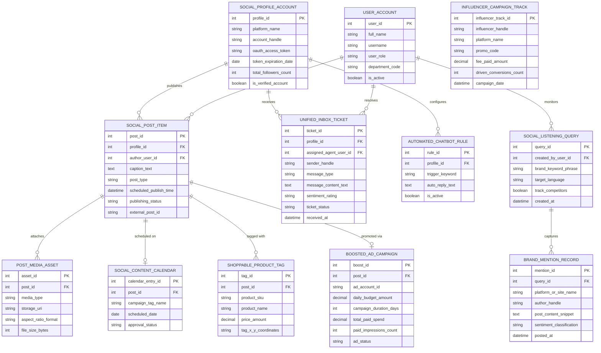

# Conceptual ERD — Social Media Marketing System

## Mermaid Code

## Entity Description Table | Bảng mô tả Entity

| # | Entity Name | Vietnamese Name | Description | Key Attributes | Main Relationships |
|---|-------------|-----------------|-------------|----------------|-------------------|
| 1 | USER_ACCOUNT | Tài khoản Nguời dùng | System user credentials and access roles for social media managers, content creators, and brand VPs. | `user_id`, `username`, `user_role`, `department_code` | Creates `SOCIAL_POST_ITEM`, resolves `UNIFIED_INBOX_TICKET`, monitors `SOCIAL_LISTENING_QUERY`. |
| 2 | SOCIAL_PROFILE_ACCOUNT | Tài khoản Mạng Xã hội | Connected social network profiles (Facebook Page, Instagram Business, X, LinkedIn, TikTok, YouTube). | `profile_id`, `platform_name`, `account_handle`, `oauth_access_token`, `total_followers_count` | Publishes `SOCIAL_POST_ITEM`, receives `UNIFIED_INBOX_TICKET`, configures `AUTOMATED_CHATBOT_RULE`. |
| 3 | SOCIAL_POST_ITEM | Bài đăng Mạng Xã hội | Master social post entity storing caption text, post type, scheduled time, and publishing status. | `post_id`, `profile_id`, `author_user_id`, `caption_text`, `post_type`, `publishing_status` | Belongs to `SOCIAL_PROFILE_ACCOUNT`, attaches `POST_MEDIA_ASSET`, scheduled on `SOCIAL_CONTENT_CALENDAR`, promoted via `BOOSTED_AD_CAMPAIGN`. |
| 4 | POST_MEDIA_ASSET | Asset Media Bài đăng | Image, video reel, or carousel media files attached to a social post with aspect ratio validation. | `asset_id`, `post_id`, `media_type`, `storage_uri`, `aspect_ratio_format`, `file_size_bytes` | Belongs to `SOCIAL_POST_ITEM`. |
| 5 | SOCIAL_CONTENT_CALENDAR | Lịch Nội dung Mạng Xã hội | Visual content calendar entry linking social posts to campaign tags, scheduled dates, and approval statuses. | `calendar_entry_id`, `post_id`, `campaign_tag_name`, `scheduled_date`, `approval_status` | Belongs to `SOCIAL_POST_ITEM`. |
| 6 | UNIFIED_INBOX_TICKET | Ticket Inbox Hợp nhất | Unified social inbox ticket consolidating DMs, comments, and mentions across networks with sentiment tags. | `ticket_id`, `profile_id`, `assigned_agent_user_id`, `sender_handle`, `message_type`, `sentiment_rating` | Belongs to `SOCIAL_PROFILE_ACCOUNT`, resolved by `USER_ACCOUNT`. |
| 7 | AUTOMATED_CHATBOT_RULE | Quy tắc Chatbot Tự động | Keyword trigger rules and automated reply templates for instant social messenger responses. | `rule_id`, `profile_id`, `trigger_keyword`, `auto_reply_text`, `is_active` | Belongs to `SOCIAL_PROFILE_ACCOUNT`. |
| 8 | SOCIAL_LISTENING_QUERY | Truy vấn Social Listening | Configured brand keyword phrases, hashtags, and competitor tracking search queries. | `query_id`, `created_by_user_id`, `brand_keyword_phrase`, `target_language`, `track_competitors` | Captures `BRAND_MENTION_RECORD`, monitored by `USER_ACCOUNT`. |
| 9 | BRAND_MENTION_RECORD | Bản ghi Nhắc tới Thương hiệu | Public web/social mention records captured by social listening engine with sentiment classifications. | `mention_id`, `query_id`, `platform_or_site_name`, `author_handle`, `sentiment_classification` | Belongs to `SOCIAL_LISTENING_QUERY`. |
| 10 | SHOPPABLE_PRODUCT_TAG | Thẻ Sản phẩm Shoppable | Interactive e-commerce product tags linked onto social post images or video coordinates. | `tag_id`, `post_id`, `product_sku`, `product_name`, `price_amount`, `tag_x_y_coordinates` | Belongs to `SOCIAL_POST_ITEM`. |
| 11 | BOOSTED_AD_CAMPAIGN | Chiến dịch Boost Bài đăng | Paid sponsored ad campaign data attached to high-performing organic posts with daily budgets. | `boost_id`, `post_id`, `ad_account_id`, `daily_budget_amount`, `paid_impressions_count`, `ad_status` | Belongs to `SOCIAL_POST_ITEM`. |
| 12 | INFLUENCER_CAMPAIGN_TRACK | Theo dõi Campaign Influencer | Sponsored influencer tracking entries recording promo code usage, post reach, and conversion numbers. | `influencer_track_id`, `influencer_handle`, `platform_name`, `promo_code`, `driven_conversions_count` | Standalone influencer marketing entity. |

## Relationship Description | Mô tả Quan hệ

| # | From Entity | Cardinality | To Entity | Label | Business Explanation |
|---|-------------|-------------|-----------|-------|----------------------|
| 1 | SOCIAL_PROFILE_ACCOUNT | 1 to 0..N | SOCIAL_POST_ITEM | publishes | A social profile account publishes multiple social post items. |
| 2 | SOCIAL_PROFILE_ACCOUNT | 1 to 0..N | UNIFIED_INBOX_TICKET | receives | A social profile account receives inbound direct messages and comments. |
| 3 | SOCIAL_PROFILE_ACCOUNT | 1 to 0..N | AUTOMATED_CHATBOT_RULE | configures | A social profile account configures automated chatbot reply rules. |
| 4 | SOCIAL_POST_ITEM | 1 to 0..N | POST_MEDIA_ASSET | attaches | A social post item attaches multiple media assets (images/videos). |
| 5 | SOCIAL_POST_ITEM | 1 to 0..1 | SOCIAL_CONTENT_CALENDAR | scheduled on | A social post item is scheduled on the visual content calendar. |
| 6 | SOCIAL_POST_ITEM | 1 to 0..N | SHOPPABLE_PRODUCT_TAG | tagged with | A social post item is tagged with shoppable product catalog items. |
| 7 | SOCIAL_POST_ITEM | 1 to 0..1 | BOOSTED_AD_CAMPAIGN | promoted via | A high-performing social post item is promoted via a boosted ad campaign. |
| 8 | SOCIAL_LISTENING_QUERY | 1 to 0..N | BRAND_MENTION_RECORD | captures | A social listening query captures public brand mention records. |
| 9 | USER_ACCOUNT | 1 to 0..N | SOCIAL_POST_ITEM | creates | A social media manager user account creates social post items. |
| 10 | USER_ACCOUNT | 1 to 0..N | UNIFIED_INBOX_TICKET | resolves | A community specialist user account resolves social inbox tickets. |
| 11 | USER_ACCOUNT | 1 to 0..N | SOCIAL_LISTENING_QUERY | monitors | A brand marketing VP user account monitors social listening queries. |
