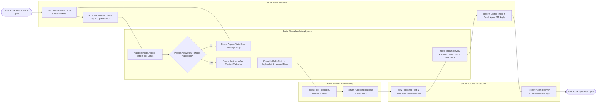

# Swimlane Diagram — Social Media Marketing System

## Mermaid Code

## Flow Description | Mô tả luồng

| Lane | Actor | Role in Flow |
|------|-------|-------------|
| 1 | Social Media Manager | Drafts cross-platform posts, attaches image/video assets, tags shoppable e-commerce SKUs, schedules publishing dates, and responds to customer DMs in the unified inbox. |
| 2 | Social Media Marketing System | Validates media file sizes and aspect ratios, queues posts in the unified content calendar, dispatches multi-platform payloads to social APIs at scheduled times, ingests inbound DMs/comments, and routes them to the unified inbox. |
| 3 | Social Network API Gateway | Receives post publishing payloads (Meta Graph API, X API, TikTok API), publishes content to social feeds, and returns real-time publishing webhooks and engagement telemetry. |
| 4 | Social Follower / Customer | Views published social posts, interacts via comments or direct messages (DMs), and receives real-time agent or automated chatbot replies in their social messenger apps. |
