# Action Tree — Social Media Marketing System

## Mermaid Code

```mermaid
graph TD
    Root["Social Media Marketing System"]

    Root --> M1["Multi-Channel Publishing & Scheduling"]
    Root --> M2["Unified Social Inbox & Community Management"]
    Root --> M3["Social Listening & Brand Sentiment"]
    Root --> M4["Social Commerce & Shoppable Tagging"]
    Root --> M5["Organic Post Boosting & Paid Ad Integration"]
    Root --> M6["Cross-Platform Analytics & Reporting"]

    M1 --> A11["Connect & Authorize Multi-Network Social Profiles"]
    M1 --> A12["Draft & Schedule Posts across Meta, X, LinkedIn, TikTok"]
    M1 --> A13["Validate Media File Sizes & Auto-Crop Aspect Ratios"]
    M1 --> A14["Manage Drag-and-Drop Unified Content Calendars"]

    M2 --> A21["Consolidate DMs, Comments & Mentions into Unified Inbox"]
    M2 --> A22["Configure Automated Chatbot Keyword FAQ Replies"]
    M2 --> A23["Route Negative Support Comments to Customer Service"]
    M2 --> A24["Filter Abusive Language & Auto-Hide Hostile Comments"]

    M3 --> A31["Scan Public Web & Social Channels for Brand Keywords"]
    M3 --> A32["Classify Brand Mention Sentiment (Positive/Negative/Neutral)"]
    M3 --> A33["Benchmark Competitor Social Share of Voice (SOV)"]
    M3 --> A34["Trigger Immediate Brand Crisis Spike Escalation Alerts"]

    M4 --> A41["Sync E-Commerce Product Catalogs to Instagram/TikTok Shops"]
    M4 --> A42["Tag Clickable Shoppable Product SKUs on Image Posts"]
    M4 --> A43["Attach Product Anchor Links to TikTok Short Video Reels"]
    M4 --> A44["Track Social Shop Order Conversions & Product Clicks"]

    M5 --> A51["Identify High-Performing Organic Posts (Engagement Rate)"]
    M5 --> A52["Convert Organic Posts to Paid Sponsored Ads via API"]
    M5 --> A53["Configure Ad Budgets, Target Audiences & CTA Buttons"]
    M5 --> A54["Compare Organic vs Paid Reach & Ad Spend Metrics"]

    M6 --> A61["Track Video Completion Rates & 3-Second Hook Retention"]
    M6 --> A62["Calculate Follower Growth Rates & Engagement Percentages"]
    M6 --> A63["Track Sponsored Influencer Promo Code Redemptions"]
    M6 --> A64["Export Executive Multi-Platform Social ROI PDF Reports"]
```

## Module Description | Mô tả Module

| # | Module | Description | Actions |
|---|--------|-------------|---------|
| 1 | Multi-Channel Publishing & Scheduling | Manages cross-platform post scheduling, media validation, aspect ratio auto-cropping, and content calendars. | Authorize Social Profiles, Schedule Multi-Platform Posts, Validate Aspect Ratios, Manage Content Calendars. |
| 2 | Unified Social Inbox & Community Management | Consolidates DMs/comments, configures automated chatbot replies, routes negative comments to support, and filters abusive text. | Consolidate DMs & Comments, Configure Chatbot Replies, Route Negative Comments, Filter Abusive Language. |
| 3 | Social Listening & Brand Sentiment | Scans web/social for brand keywords, classifies sentiment, benchmarks competitor Share of Voice, and alerts on brand crises. | Scan Public Web & Social, Classify Brand Sentiment, Benchmark Competitor SOV, Trigger Crisis Alerts. |
| 4 | Social Commerce & Shoppable Tagging | Syncs product catalogs, tags clickable SKUs on images/reels, attaches TikTok shop anchors, and tracks social shop sales. | Sync E-Commerce Catalogs, Tag Shoppable Products, Attach TikTok Product Anchors, Track Social Shop Sales. |
| 5 | Organic Post Boosting & Paid Ad Integration | Identifies high-performing posts, converts organic posts into paid ads, configures budgets/targeting, and compares paid vs organic reach. | Identify High-Performing Posts, Convert Organic Posts to Ads, Configure Ad Budgets & Targeting, Compare Paid vs Organic Reach. |
| 6 | Cross-Platform Analytics & Reporting | Tracks video retention rates, follower growth, influencer promo codes, and exports executive multi-platform ROI reports. | Track Video Completion Rates, Calculate Follower Growth, Track Influencer Promo Codes, Export Executive ROI Reports. |
