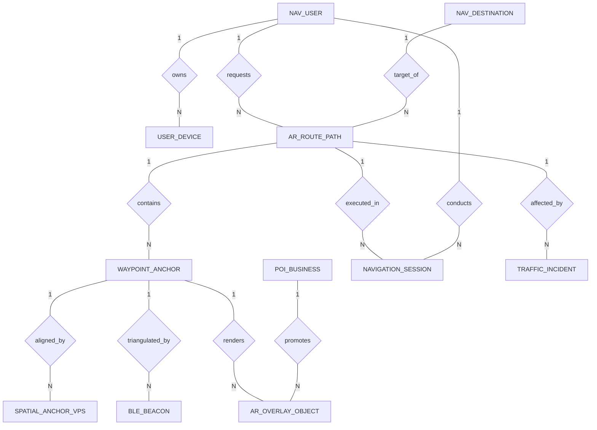

# Conceptual ERD — Augmented Reality Navigation System

## Mermaid Code

## Entity Description Table | Bảng mô tả Entity

| # | Entity Name | Vietnamese Name | Description | Key Attributes | Main Relationships |
|---|-------------|-----------------|-------------|----------------|-------------------|
| 1 | NAV_USER | Người dùng Định vị | AR system user profile storing navigation mode (Walking, Driving) and accessibility options. | user_id (PK), full_name, preferred_nav_mode, accessibility_setting | Owns User Devices, requests AR Route Paths, conducts Navigation Sessions |
| 2 | USER_DEVICE | Thiết bị Smart Glasses / Phone | Hardware device specifications (Apple Vision Pro, iPhone LiDAR, Android ARCore). | device_id (PK), user_id (FK), device_model, os_version, has_lidar_sensor | Owned by Nav User |
| 3 | NAV_DESTINATION | Điểm đến Navigation | Target location geocoded into latitude, longitude, altitude, and floor level. | destination_id (PK), destination_name, latitude, longitude, floor_level | Target of AR Route Paths |
| 4 | AR_ROUTE_PATH | Tuyến đường 3D AR | Calculated 3D spatial navigation path connecting origin to target destination. | route_id (PK), user_id (FK), destination_id (FK), total_distance_meters, route_type | Requested by User, target of Destination, contains Waypoint Anchors |
| 5 | WAYPOINT_ANCHOR | Điểm chốt 3D Waypoint | Individual 3D spatial coordinate waypoint along the route containing turn commands. | waypoint_id (PK), route_id (FK), step_order, pos_x, pos_y, pos_z, turn_command | Belongs to AR Route Path, aligned by VPS Anchors, renders AR Overlay Objects |
| 6 | SPATIAL_ANCHOR_VPS | Anchor VPS 3D | Cloud Visual Positioning System (VPS) 3D feature point cloud anchor for camera alignment. | anchor_id (PK), anchor_token, geo_latitude, geo_longitude, feature_cloud_uri | Aligns Waypoint Anchors |
| 7 | BLE_BEACON | Beacon Bluetooth Indoor | Low-power Bluetooth BLE beacon deployed inside buildings for indoor location. | beacon_id (PK), beacon_uuid, major_id, minor_id, floor_level, beacon_pos_x | Triangulates Waypoint Anchors |
| 8 | POI_BUSINESS | Địa điểm POI Doanh nghiệp | Point of Interest storefront business profile with ratings, hours, and catalog links. | poi_id (PK), business_name, category, rating_score, opening_hours | Promotes AR Overlay Objects |
| 9 | AR_OVERLAY_OBJECT | Vật thể Đồ họa AR 3D | 3D virtual directional arrow, glowing ribbon mesh, or floating POI business card. | overlay_id (PK), waypoint_id (FK), poi_id (FK), object_type, gltf_model_uri | Rendered at Waypoint Anchor, promotes POI Business |
| 10 | NAVIGATION_SESSION | Phiên Định vị Thực tế | Active navigation session tracking real-time user movement, ETA accuracy, and completion status. | session_id (PK), user_id (FK), route_id (FK), start_time, completion_status | Conducted by User, executes AR Route Path |
| 11 | TRAFFIC_INCIDENT | Sự cố Giao thông / Obstacle | Road closure, construction hazard, or crowd congestion incident affecting route calculation. | incident_id (PK), latitude, longitude, hazard_type, severity | Affects AR Route Paths |

## Relationship Description | Mô tả Quan hệ

| # | From Entity | Cardinality | To Entity | Relationship Label | Business Explanation |
|---|-------------|-------------|-----------|-------------------|----------------------|
| 1 | NAV_USER | one-to-many | USER_DEVICE | owns | A Nav User owns one or multiple User Devices. |
| 2 | NAV_USER | one-to-many | AR_ROUTE_PATH | requests | A Nav User requests multiple AR Route Paths over time. |
| 3 | NAV_DESTINATION | one-to-many | AR_ROUTE_PATH | target_of | A Nav Destination is the target of multiple AR Route Paths. |
| 4 | AR_ROUTE_PATH | one-to-many | WAYPOINT_ANCHOR | contains | An AR Route Path contains multiple ordered Waypoint Anchors. |
| 5 | AR_ROUTE_PATH | one-to-many | NAVIGATION_SESSION | executed_in | An AR Route Path is executed in multiple Navigation Sessions. |
| 6 | NAV_USER | one-to-many | NAVIGATION_SESSION | conducts | A Nav User conducts multiple active Navigation Sessions. |
| 7 | WAYPOINT_ANCHOR | one-to-many | SPATIAL_ANCHOR_VPS | aligned_by | A Waypoint Anchor is aligned by Cloud Spatial VPS Anchors. |
| 8 | WAYPOINT_ANCHOR | many-to-many | BLE_BEACON | triangulated_by | Indoor Waypoint Anchors are triangulated by BLE Beacons. |
| 9 | WAYPOINT_ANCHOR | one-to-many | AR_OVERLAY_OBJECT | renders | A Waypoint Anchor renders one or more 3D AR Overlay Objects. |
| 10 | POI_BUSINESS | one-to-many | AR_OVERLAY_OBJECT | promotes | A POI Business promotes sponsored 3D AR Overlay Objects. |
| 11 | AR_ROUTE_PATH | many-to-many | TRAFFIC_INCIDENT | affected_by | AR Route Paths can be affected by real-time Traffic Incidents. |
