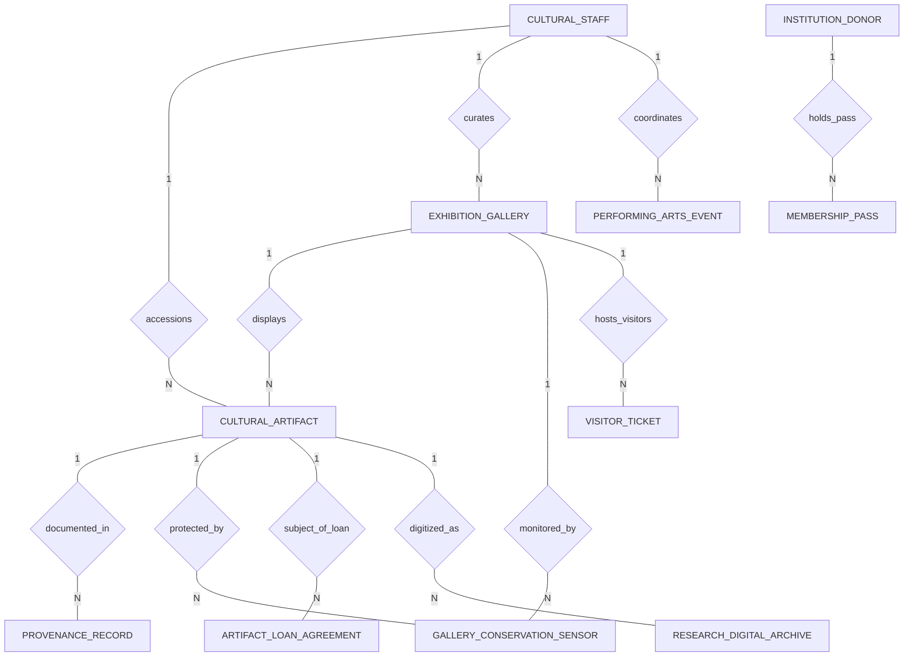

# Conceptual ERD — Cultural Institution Management System

## Mermaid Code

## Entity Description Table | Bảng mô tả Entity

| # | Entity Name | Vietnamese Name | Description | Key Attributes | Main Relationships |
|---|-------------|-----------------|-------------|----------------|-------------------|
| 1 | CULTURAL_STAFF | Nhân viên Văn hóa | Museum curators, conservators, art registrars, and theater directors managing operations. | staff_id (PK), full_name, staff_role, department, email | Accessions Artifacts, curates Galleries, coordinates Events |
| 2 | CULTURAL_ARTIFACT | Cổ vật / Tác phẩm | Cataloged museum artifact or artwork with accession number, materials, and valuation. | artifact_id (PK), accession_number, object_name, culture_period, appraisal_value_usd | Documented in Provenance, displayed in Gallery, subject of Loan |
| 3 | PROVENANCE_RECORD | Nhật ký Lai lịch | Historical ownership chain record documenting previous owners, titles, and acquisition dates. | provenance_id (PK), artifact_id (FK), previous_owner_name, acquisition_year | Belongs to Cultural Artifact |
| 4 | EXHIBITION_GALLERY | Phòng Trưng bày | Physical exhibition hall or gallery room with environmental targets and capacity limits. | gallery_id (PK), gallery_name, wing_building, max_capacity_visitors, temp_target_celsius | Displays Artifacts, monitored by Sensors, hosts Visitor Tickets |
| 5 | GALLERY_CONSERVATION_SENSOR | Cảm biến Bảo quản | IoT sensor recording temperature, relative humidity, lux light, and UV index inside cases. | sensor_id (PK), gallery_id (FK), artifact_id (FK), temperature_celsius, lux_light_level | Monitors Gallery, protects Cultural Artifact |
| 6 | VISITOR_TICKET | Vé Tham quan | Visitor entry pass with QR code, timed-entry slot, category, and gate admission status. | ticket_id (PK), gallery_id (FK), qr_ticket_code, visitor_category, timed_entry_slot | Hosted in Exhibition Gallery |
| 7 | PERFORMING_ARTS_EVENT | Sự kiện Biểu diễn | Theater play, concert, lecture, or film event scheduled in institution auditoriums. | event_id (PK), production_title, performer_name, venue_auditorium, showtime | Coordinated by Cultural Staff |
| 8 | ARTIFACT_LOAN_AGREEMENT | Hợp đồng Mượn Cổ vật | Inter-museum loan contract for incoming/outgoing artifact exchange and insurance. | loan_id (PK), artifact_id (FK), borrowing_institution, loan_direction, insurance_coverage_usd | Subject of Cultural Artifact |
| 9 | INSTITUTION_DONOR | Nhà Tài trợ | Philanthropic donor or patron providing financial gifts, endowments, and sponsorships. | donor_id (PK), donor_name, donor_tier, total_contributions_usd, naming_rights_granted | Holds Membership Passes |
| 10 | MEMBERSHIP_PASS | Thẻ Thành viên Patron | Annual museum membership subscription pass granting free gallery access and benefits. | membership_id (PK), donor_id (FK), pass_number, membership_level, valid_until | Held by Institution Donor |
| 11 | RESEARCH_DIGITAL_ARCHIVE | Kho Lưu trữ Số | High-resolution digital asset (3D photogrammetry mesh, IIIF image manifest) for research. | archive_id (PK), artifact_id (FK), digital_asset_type, iiif_manifest_uri, 3d_model_format | Digitizes Cultural Artifact |

## Relationship Description | Mô tả Quan hệ

| # | From Entity | Cardinality | To Entity | Relationship Label | Business Explanation |
|---|-------------|-------------|-----------|-------------------|----------------------|
| 1 | CULTURAL_STAFF | one-to-many | CULTURAL_ARTIFACT | accessions | Cultural Staff accessions multiple Cultural Artifacts into the collection. |
| 2 | CULTURAL_ARTIFACT | one-to-many | PROVENANCE_RECORD | documented_in | A Cultural Artifact is documented in multiple Provenance Records over time. |
| 3 | EXHIBITION_GALLERY | one-to-many | CULTURAL_ARTIFACT | displays | An Exhibition Gallery displays multiple Cultural Artifacts. |
| 4 | EXHIBITION_GALLERY | one-to-many | GALLERY_CONSERVATION_SENSOR | monitored_by | An Exhibition Gallery is monitored by multiple Gallery Conservation Sensors. |
| 5 | CULTURAL_ARTIFACT | one-to-many | GALLERY_CONSERVATION_SENSOR | protected_by | A Cultural Artifact is protected by Gallery Conservation Sensors inside its case. |
| 6 | EXHIBITION_GALLERY | one-to-many | VISITOR_TICKET | hosts_visitors | An Exhibition Gallery hosts visitors via Visitor Tickets. |
| 7 | CULTURAL_ARTIFACT | one-to-many | ARTIFACT_LOAN_AGREEMENT | subject_of_loan | A Cultural Artifact can be the subject of multiple Artifact Loan Agreements. |
| 8 | INSTITUTION_DONOR | one-to-many | MEMBERSHIP_PASS | holds_pass | An Institution Donor holds one or more Membership Passes. |
| 9 | CULTURAL_ARTIFACT | one-to-many | RESEARCH_DIGITAL_ARCHIVE | digitized_as | A Cultural Artifact is digitized as Research Digital Archives (3D/IIIF). |
| 10 | CULTURAL_STAFF | one-to-many | EXHIBITION_GALLERY | curates | Cultural Staff (Curators) curates multiple Exhibition Galleries. |
| 11 | CULTURAL_STAFF | one-to-many | PERFORMING_ARTS_EVENT | coordinates | Cultural Staff coordinates multiple Performing Arts Events. |
